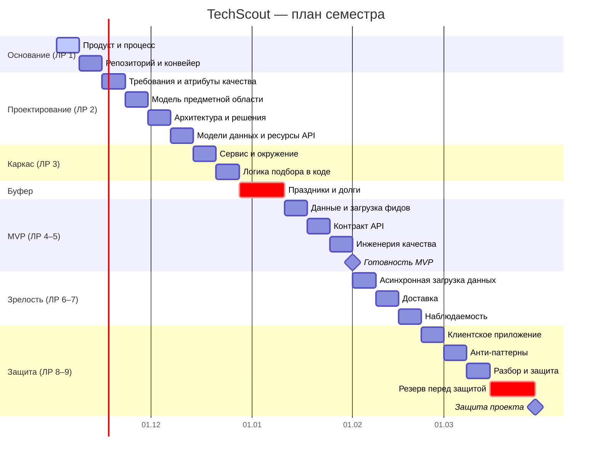

# План семестра — TechScout

План построен **от цели**: обратным отсчётом от защиты по модулям курса, по одному модулю в неделю. Скорость команды пока неизвестна, поэтому после первых двух спринтов план сверяется с фактической скоростью и при необходимости уточняется. Даты ориентировочные и согласуются с календарём курса.

## Контрольные точки

| Точка | Срок | Критерий прохождения |
|---|---|---|
| Требования утверждены | конец М01 | Домен согласован, MVP и границы зафиксированы |
| Конвейер зелёный | конец М02 | Основная ветка защищена, проверки проходят, у каждого есть запрос с ревью |
| Проект системы принят | конец М06 | ЛР 2 зачтена: требования, модель, решения, диаграммы, ресурсы API |
| Сервис поднимается | конец М07 | Одна команда — работающее окружение |
| MVP работает | конец М11 | Путь «описал задачу → подтвердил профиль → до трёх моделей → понял различия → выбрал» проходит целиком |
| Загрузка асинхронная | конец М12 | Загрузка каталога обрабатывается в фоне, отчёт об ошибках появляется после обработки |
| Готовность к защите | конец М17 | Клиент работает, гипотеза проверена на участниках, демонстрация повторяема |

## Буфер

Заложено **4 недели буфера на 17 недель работы (около 23%)**, двумя явными блоками:

- **2 недели после М08** — новогодние праздники и закрытие долгов по ЛР 2–3;
- **2 недели перед защитой** — исправления по итогам проверки на участниках и запас на сдвиг сроков курса.

Буфер не размазан по задачам. Каждый расход буфера записывается в [CHANGELOG.md](CHANGELOG.md) с причиной.
