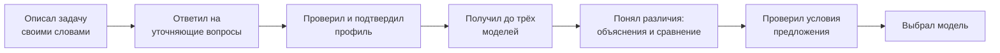

# Требования — TechScout

**Версия:** 0.1.0

**Этап:** ЛР 1А — продукт и процесс. Идентификаторы требований, критерии приёмки и приоритеты появятся в ЛР 2А.

## Предметная область

Рассмотрены три кандидата. Каждый проверен по четырём требованиям курса.

### Кандидат 1. Независимый ИИ-консультант по выбору техники

| Требование | Проверка | Итог |
|---|---|---|
| 2–3 ограниченных контекста | Описание потребности и профиль · Каталог моделей · Предложения магазинов · Подбор и объяснение · Управление данными | ✅ пять |
| Внешняя интеграция | Языковая модель для распознавания пожеланий; в следующих релизах — источники предложений магазинов | ✅ |
| Пользовательский интерфейс | Описание задачи, профиль, подборка, сравнение, предложения, раздел управления данными | ✅ |
| Нетривиальные данные | Модели и модификации, характеристики с источником и датой, сроки обновлений, профили требований, предложения, загрузки со статусами принятых и отклонённых записей | ✅ связи, состояния, происхождение данных |

**Вывод:** домен проходит.

### Кандидат 2. Трекер растений с соседской передержкой

| Требование | Проверка | Итог |
|---|---|---|
| 2–3 ограниченных контекста | Растения и расписания ухода · Заявки на передержку · Баллы и репутация | ✅ три |
| Внешняя интеграция | Уведомления, геолокация | ✅ |
| Пользовательский интерфейс | Список растений, календарь ухода, поиск соседа | ✅ |
| Нетривиальные данные | Расписания, заявки со статусами, баллы | ✅ |

**Вывод:** домен проходит, но проблема узкая: проверить гипотезу на реальных пользователях за семестр трудно, потому что передержка нужна редко.

### Кандидат 3. Раздел общих трат по фото чека

| Требование | Проверка | Итог |
|---|---|---|
| 2–3 ограниченных контекста | Группы · Чеки и позиции · Взаимные долги | ✅ три |
| Внешняя интеграция | Распознавание чека | ✅ одна |
| Пользовательский интерфейс | Группа, чек, кто кому должен | ✅ |
| Нетривиальные данные | Позиции, доли, долги | ✅ |

**Вывод:** домен проходит, но рынок занят готовыми приложениями, и свою логику показать сложнее.

### Выбор

Выбран **кандидат 1**. У него самая сильная и массовая боль, больше всего контекстов, а гипотезу можно проверить в семестре на однокурсниках и родственниках, которые выбирают телефон. Домен утверждается преподавателем.

**Объём семестра.** Видение — консультант по любой технике, где выбор зависит от характеристик. В семестре делается одна категория — **смартфоны**, и это осознанный выбор команды: телефоны выбирать сложнее всего. Нужно учитывать, сколько лет модель будет получать обновления системы, оценивать камеру не по мегапикселям, а автономность не по ёмкости батареи, различать региональные версии и тип гарантии. Если подход работает на самой «болючей» категории, он перенесётся и на более простые: среди ноутбуков одной ценовой категории различия обычно меньше и понятнее. Продукт устроен так, что категория описывается данными (характеристики, сценарии использования, вопросы), поэтому следующие категории добавляются без переделки. Обоснование и бизнес-модель — в [business-model.md](business-model.md).

## Постановка проблемы

**Что:** человек без технической подготовки не может связать характеристики смартфона со своими задачами и сроком, на который покупает телефон. Привычные числа вводят в заблуждение: мегапиксели не говорят, как телефон снимает, ёмкость батареи — сколько он проработает. О сроке обновлений системы в магазинах не пишут, а версии одной модели (память, регион, гарантия) легко перепутать. В итоге человек выбирает по совету продавца или знакомого и не может объяснить свой выбор.

**Для кого:** люди, которые покупают смартфон раз в несколько лет и не следят за рынком.

**Зачем:** человек за несколько минут получает до трёх подходящих моделей с объяснением на языке своих задач, видит срок поддержки и условия предложения и может сам обосновать выбор.

**Как измерим успех:**

- доля участников теста, которые без помощи команды получили вариант, подходящий по их обязательным условиям (цель — не менее 80%);
- доля участников, которые смогли своими словами объяснить, почему выбрали модель (цель — не менее 70%);
- медианное время от начала описания задачи до подборки (цель — не более 5 минут);
- ноль случаев, когда подборка нарушила подтверждённое обязательное условие или бюджет с учётом доставки.

Точные значения и методика измерения уточняются в ЛР 2А.

## Персоны

### Персона: Покупатель без технической подготовки

**Роль и контекст:** выбирает смартфон взамен старого раз в несколько лет; пользуется мессенджерами, видео, рабочими приложениями, банком и камерой; бюджет ограничен.

**Цель:** выбрать телефон, который подходит под его задачи и прослужит нужный срок, и понять, за что он платит и какие ограничения принимает.

**Как решает задачу сейчас:** открывает магазины, читает обзоры и подборки, просит совета у знакомых, сравнивает характеристики вручную.

**Боли:**

- не умеет переводить бытовые задачи в технические параметры;
- сравнивает по мегапикселям и мА·ч, которые не отвечают на его вопросы;
- не знает, сколько лет телефон будет получать обновления;
- путается в версиях, памяти и типе гарантии;
- получает противоречивые советы.

**Что для него важно в решении:** понятные вопросы, соблюдение бюджета, объяснение выбора на языке его задач, срок поддержки, возможность исправить неверно понятые пожелания.

### Персона: Администратор каталога

**Роль и контекст:** сотрудник небольшого сервиса, который поддерживает каталог смартфонов и предложения. В учебном проекте роль выполняет участник команды, но она не совпадает с ролью разработчика.

**Цель:** дать подбору согласованные и проверяемые данные и не публиковать неполные или ошибочно сопоставленные записи.

**Как решает задачу сейчас:** собирает данные в таблицы, сверяет модели и модификации, вручную ищет пропуски и несоответствия.

**Боли:**

- разные названия одного устройства, смешение памяти и региональных версий;
- пропуски характеристик, сроки обновлений разбросаны по сайтам производителей;
- неясно, какие записи загружены и какие устарели.

**Что для него важно в решении:** понятный формат загрузки, сообщения об ошибках, источник и дата проверки у каждого значения, возможность исключить проблемную запись из подбора.

Персоны — гипотезы команды; они уточняются после разговоров с потенциальными пользователями.

## Путь пользователя: подобрать смартфон

**Персона:** Покупатель без технической подготовки.

**Сценарий:** выбрать смартфон под свои задачи, бюджет и срок использования.

1. **Описал задачу своими словами** — «для фото детей и банка, чтобы держал весь день, до 30 тысяч, пользоваться года три».
2. **Ответил на уточняющие вопросы** — например, о размере и оплате телефоном; если распознавание не сработало, заполнил анкету.
3. **Проверил и подтвердил профиль** — бюджет, обязательные условия, предпочтения и срок использования на понятном языке.
4. **Получил до трёх моделей** — только те, что проходят все обязательные условия и бюджет с доставкой; если таких нет, сервис объясняет почему.
5. **Понял различия** — объяснение камеры и автономности через его сценарии, срок обновлений, общая таблица сравнения, источник и дата данных.
6. **Проверил условия предложения** — память, региональная версия, тип гарантии, цена с доставкой; предложения помечены как учебные.
7. **Выбрал модель** — или изменил условия и повторил подбор.

## Минимально жизнеспособный продукт

**Входит:**

- описание задачи обычным текстом и анкета как запасной путь;
- уточняющие вопросы, срок использования, просмотр, правка и подтверждение профиля;
- подбор до трёх моделей по явным правилам с учётом бюджета с доставкой; понятный пустой результат;
- объяснения через сценарии, срок обновлений по заявлению производителя, общая таблица сравнения, источник и дата данных;
- условия учебных предложений точной модификации с заметной маркировкой;
- изменение условий и повторный подбор;
- раздел управления данными для администратора: вход, загрузка каталога и предложений, отчёт о принятых и отклонённых записях, исключение ошибочных записей.

**Критерий:** покупатель без технической подготовки проходит путь «описал задачу → подтвердил профиль → получил до трёх моделей → понял различия → выбрал модель» без помощи команды и может объяснить свой выбор.

**Следующие релизы:** v1.1 — повторное использование профиля, сохранённое сравнение, ссылка на результат, история изменений каталога; v1.2 — настоящие предложения магазинов, подписка на цену, регулярное получение внешних данных. Полная карта — в [user-story-map.md](user-story-map.md).

## Вне области охвата этого семестра

| Не делаем | Почему |
|---|---|
| Другие категории техники | Каждая категория требует своих характеристик и правил; подход проверяется на самой сложной — смартфонах. Категория описывается данными, поэтому расширение не требует переделки пути |
| Сбор данных с сайтов магазинов и актуальные цены всего рынка | Нарушает правила площадок и требует постоянной поддержки источников; в MVP — учебные предложения |
| Нечёткое сопоставление «грязных» названий | В MVP загрузка только согласованного формата с явными идентификаторами |
| Регистрация покупателей | Основной сценарий проходится без учётной записи |
| Покупка, оплата, доставка и возвраты | Это процессы магазина; цель TechScout — помочь с выбором |
| Свободно генерируемые обзоры | Трудно гарантировать, что текст опирается только на проверенные факты |
| Обучение собственной языковой модели | Не нужно для распознавания пожеланий в ограниченном сценарии |
| Кабинет продавца и платное продвижение | Не нужны для проверки пользы подбора и подрывают доверие |

## Предположения

- Каталога из 20–30 популярных моделей хватает, чтобы подборка была осмысленной.
- Производители публикуют политику обновлений для большинства моделей; где её нет, сервис честно показывает «неизвестно».
- Языковая модель надёжно превращает свободный текст в профиль требований; если нет — запасной путь через анкету.
- Учебные предложения достаточно похожи на настоящие, чтобы проверить сценарий выбора.
- Целевые показатели проверяются в пилоте и до этого не считаются подтверждёнными.
