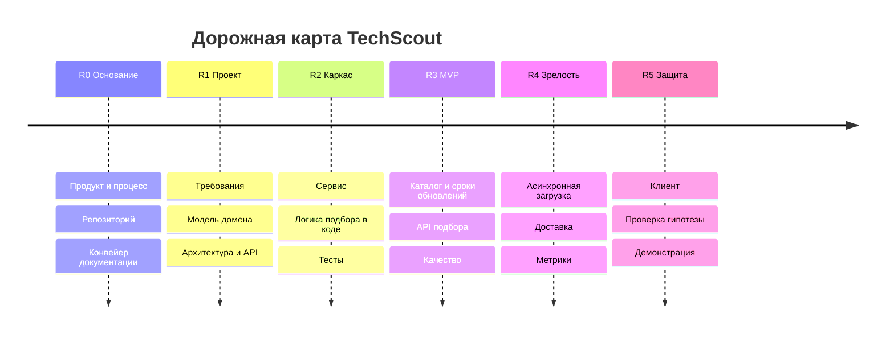

# Дорожная карта — TechScout

Вехи привязаны к модулям курса. Точных дат внутри вехи нет: план по неделям — в [gantt.md](gantt.md).

| Веха | Модули | Что будет готово |
|---|---|---|
| **R0. Основание** | М01–М02 | Домен, проблема, персоны, путь, CJM, карта историй, MVP и границы; репозиторий с защищённой веткой и конвейером проверки документации |
| **R1. Проект** | М03–М06 | Требования с идентификаторами и критериями, требования к качеству с числами; модель предметной области (контексты: профиль потребностей, каталог, предложения, подбор, управление данными); архитектурные решения; диаграммы; модель данных; перечень ресурсов API |
| **R2. Каркас** | М07–М08 | Сервис поднимается одной командой; логика подбора и ранжирования в коде и покрыта тестами |
| **R3. MVP** | М09–М11 | Каталог 20–30 смартфонов со сроками обновлений, учебные предложения, загрузка и отчёт об ошибках, API подбора; стратегия тестирования; путь от описания задачи до выбора модели работает через API |
| **R4. Зрелость** | М12–М14 | Асинхронная обработка загрузок каталога и предложений; при наличии времени — релиз v1.1 (сохранённый профиль и сравнение, ссылка на результат, история изменений); доставка через конвейер, метрики и журналы |
| **R5. Защита** | М15–М17 | Клиентское приложение со всем путём покупателя и разделом управления данными; разбор анти-паттернов; проверка гипотезы на тестовых участниках; демонстрация |

**Если отстаём.** Первым урезается релиз v1.1, затем раздел управления данными сводится к загрузке и отчёту об ошибках. Путь покупателя от описания задачи до выбора модели не урезается.
